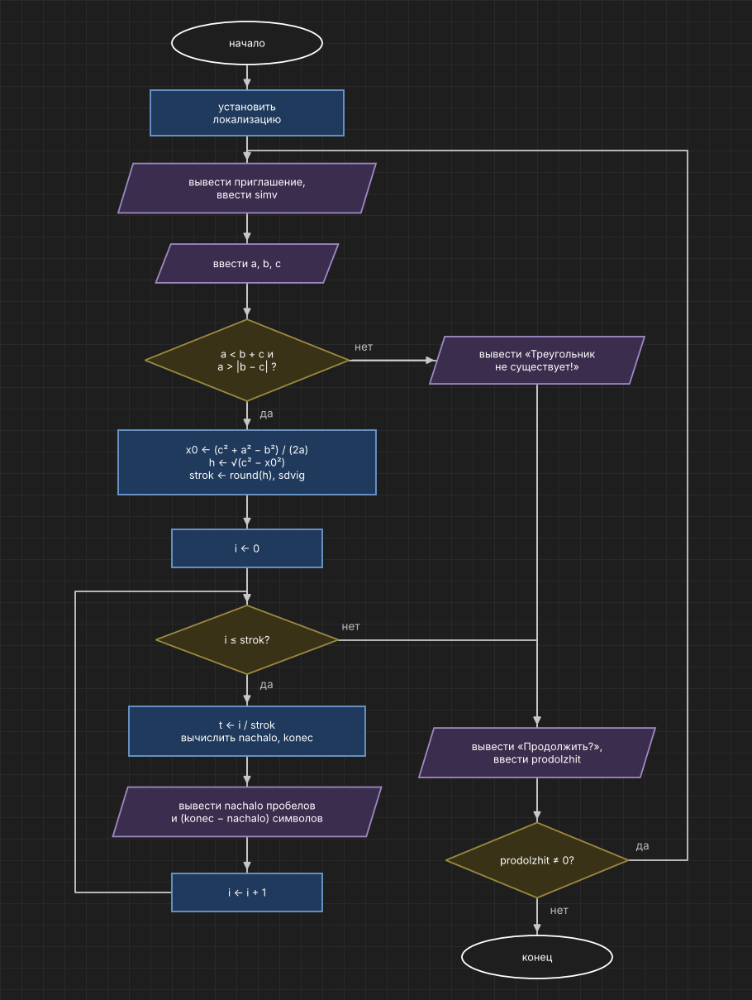

# Домашнее задание к работе 9

## Вариант 14

## Условие задачи

Написать программу, выводящую на экран заданную геометрическую фигуру, нарисованную с помощью заданного с клавиатуры символа. Предусмотреть возможность изменения размеров фигуры путем задания ее размеров в количестве символов пользователем.

Фигура: треугольник. Заполнение контура: да. Задаваемые пользователем параметры: a, b, c.

## 1. Алгоритм и блок-схема

### Алгоритм

1. Начало.
2. Установить локализацию.
3. Вывести приглашение и ввести `simv` — символ.
4. Ввести стороны `a`, `b`, `c`.
5. Если `a < b + c` и `a > |b − c|`:
   - `x0 = (c² + a² − b²) / (2a)`, `h = √(c² − x0²)`;
   - `strok = round(h)`, `sdvig = round(−x0)` если `x0 < 0`, иначе 0;
   - цикл по `i` от 0 до `strok`:
     - `t = i / strok`;
     - `nachalo = round(x0 · (1 − t)) + sdvig`, `konec = round(x0 + t · (a − x0)) + sdvig`;
     - вывести `nachalo` пробелов и `konec − nachalo` символов `simv`.
6. Иначе вывести, что треугольник не существует.
7. Вывести «Продолжить?» и ввести `prodolzhit`.
8. Если `prodolzhit ≠ 0` — перейти к пункту 3.
9. Конец.

### Блок-схема



## 2. Реализация программы

```c
#define _CRT_SECURE_NO_WARNINGS
#include <stdio.h>
#include <stdlib.h>
#include <math.h>
#include <locale.h>

int main()
{
    char simv;
    int a, b, c;
    int prodolzhit;
    double x0, h, t, levo, pravo;
    int strok, i, j, sdvig, nachalo, konec;

    setlocale(LC_ALL, "Rus");

    do
    {
        printf("Введите символ из которого будет строиться фигура:\n");
        scanf(" %c", &simv);
        printf("Введите сторону a:\n");
        scanf("%d", &a);
        printf("Введите сторону b:\n");
        scanf("%d", &b);
        printf("Введите сторону c:\n");
        scanf("%d", &c);

        if (a < b + c && a > abs(b - c))
        {
            printf("Треугольник:\n\n");

            x0 = (c * c + a * a - b * b) / (2.0 * a);
            h = sqrt(c * c - x0 * x0);
            strok = (int)(h + 0.5);
            if (strok < 1)
                strok = 1;
            sdvig = 0;
            if (x0 < 0)
                sdvig = (int)floor(-x0 + 0.5);

            for (i = 0; i <= strok; i++)
            {
                t = (double)i / strok;
                levo = x0 * (1 - t);
                pravo = x0 + t * (a - x0);
                nachalo = (int)floor(levo + 0.5) + sdvig;
                konec = (int)floor(pravo + 0.5) + sdvig;
                if (konec <= nachalo)
                    konec = nachalo + 1;

                for (j = 0; j < nachalo; j++)
                    putchar(' ');
                for (j = nachalo; j < konec; j++)
                    putchar(simv);
                printf("\n");
            }
        }
        else
            printf("Треугольник с такими сторонами не существует!\n");

        prodolzhit = 0;
        printf("\nПродолжить ? (Да - введите любое число, Нет - введите 0)\n");
        scanf("%d", &prodolzhit);
    } while (prodolzhit != 0);

    return 0;
}
```

## 3. Результаты работы программы

```
Введите символ из которого будет строиться фигура:
*
Введите сторону a:
10
Введите сторону b:
8
Введите сторону c:
6
Треугольник:

    *
   **
  ****
 ******
 ********
**********

Продолжить ? (Да - введите любое число, Нет - введите 0)
1
Введите символ из которого будет строиться фигура:
#
Введите сторону a:
10
Введите сторону b:
10
Введите сторону c:
10
Треугольник:

     #
    ##
    ##
   ####
   ####
  ######
  ######
 ########
 ########
##########

Продолжить ? (Да - введите любое число, Нет - введите 0)
1
Введите символ из которого будет строиться фигура:
@
Введите сторону a:
5
Введите сторону b:
12
Введите сторону c:
9
Треугольник:

@
 @
 @
  @@
  @@@
   @@@
   @@@@
    @@@@
    @@@@@

Продолжить ? (Да - введите любое число, Нет - введите 0)
1
Введите символ из которого будет строиться фигура:
+
Введите сторону a:
3
Введите сторону b:
1
Введите сторону c:
1
Треугольник с такими сторонами не существует!

Продолжить ? (Да - введите любое число, Нет - введите 0)
0
```

## 4. Информация о разработчике

Кочергин Савелий, группа бИД-261
